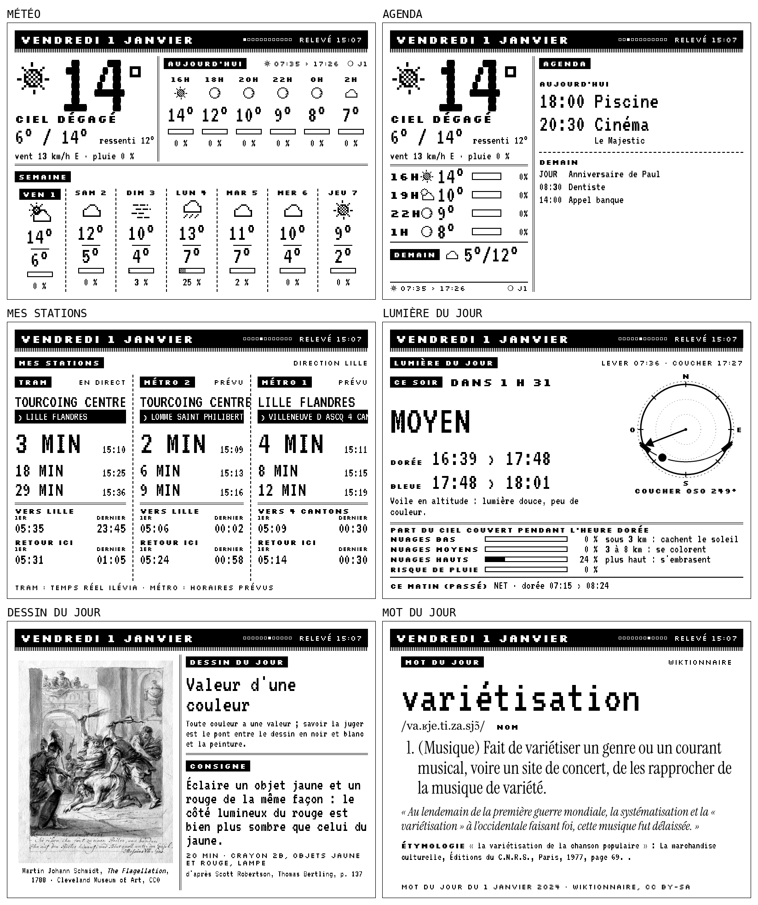

**English** | [Français](README.fr.md)

# Kindle dashboard

**My old Kindle 4 is now an always-on e-ink display and dashboard: weather, air quality, calendar, mail, live tram and metro times, drawing of the day, light for photography, word of the day, quote, odd Wikipedia article, end-of-day recap, and my activity numbers.**

My Mac makes the images, the e-reader only shows them. Every minute, a script gathers the data, fills in an HTML page, photographs it with Chromium at the exact size of the panel and converts it to 16 grays. The jailbroken Kindle, plugged into a charger, reads the Mac's state over wifi every 20 seconds and only downloads the screen if it changed. Neo-retro style: pixel fonts at their native sizes, inverted titles, dither patterns, no gray text.



*Screens made by `demo.py`, without any account (fictional calendar). On the Kindle, they come out at 800 × 600, 16 grays, rotated to match the panel.*

> I'm Thomas Hammoudi, a photographer. I built all of this with Claude Code, in 2026. The code and the other documents are in French.

## Try it in two minutes, without a Kindle

```bash
git clone https://github.com/ThomasHMD/kindle-dashboard
cd kindle-dashboard
python3 -m pip install -r requirements.txt
python3 -m playwright install chromium
python3 demo.py
```

The screens land in `demo/`: `apercu-<screen>.png` (landscape, for the eye) and `ecran-<screen>.png` (rotated, the file the Kindle displays). Without a `config.json`, `demo.py` uses the settings from [`config.exemple.json`](config.exemple.json): Lille weather, three stops of the ilévia network, no real calendar or mail.

## The screens

| Screen | What it shows | Source | Needs |
|---|---|---|---|
| Weather | now, feels-like, wind, rain, the day in 2-hour steps, 7 days, sunrise and sunset, moon phase | [Open-Meteo](https://open-meteo.com/) | nothing |
| Air quality | European index and its level, advice, main pollutant, 24-hour index, particles, nitrogen dioxide and ozone explained on screen, best time to air the house, pollen in season | [Open-Meteo](https://open-meteo.com/en/docs/air-quality-api) | nothing |
| Calendar | today's and tomorrow's appointments, past ones removed | Google Calendar, read-only | an OAuth client, `autoriser.py` |
| Mail | unread mails that Gmail marks "Important", screen skipped if there are none | Gmail, read-only | same |
| Subscribers | subscribers per network, daily gain over 30 days | an [n8n](https://n8n.io/) table filled every day by a workflow | `N8N_API_KEY`, optional |
| My activity | latest long YouTube video and latest reel with their views; sales and new sign-ups of the day, over 7 days and for the month | YouTube, Instagram API, a Notion database, Brevo | the keys for each source, optional, see `activite` |
| My stops | next 3 departures, direction, first and last departure of the day, first and last return | ilévia (Lille): real time and GTFS | nothing |
| Daylight | next photo moment (this morning, this evening or tomorrow morning) and its verdict (clear, promising, average, blocked, rain), blue and golden hours, compass of the sun's path, share of sky covered per cloud layer during the golden hour, each layer explained on screen | local calculation (NOAA formulas) and Open-Meteo | nothing |
| Drawing of the day | a concept, a 10 to 30 minute prompt, an old public-domain drawing | [`consignes-dessin.json`](consignes-dessin.json), [Cleveland Museum of Art](https://openaccess-api.clevelandart.org/) (CC0) | nothing (Notion, optional) |
| Book to read | a book from my library that I haven't read yet, dithered cover | a Notion database | `NOTION_TOKEN`, optional |
| Word of the day | word, pronunciation, definitions, example, etymology | [Wiktionary](https://fr.wiktionary.org/) (French) | nothing |
| Quote | in the morning Wikiquote's quote of the day if there is one, otherwise one from the bank | [`citations.json`](citations.json) | nothing |
| Planes | the planes flying around my home: where they come from, where they go, airline, altitude, speed, radar seen from above, next 4 flights; a route inconsistent with the position is discarded | [adsb.lol](https://www.adsb.lol/), [adsbdb](https://www.adsbdb.com/) | nothing |
| Odd article | an article from Wikipedia's "Unusual articles" page, its blurb, its summary and its image | [`insolites.json`](insolites.json), Wikipedia API | nothing |
| End of day | from 5 pm: tomorrow's weather, first appointment, bins to put out | Open-Meteo, Google Calendar | same as Calendar |
| Tomorrow | at night, tomorrow's appointments | Google Calendar | same as Calendar |

The top banner carries the date, one box per screen (filled for the one displayed), the number of important mails, and the evening before collection a reminder for the bins. A screen with no setting (no stop, no Notion database) drops out of the rotation and the buttons. A source that is down shows a message in its block: the screen is always produced.

## Mac side

You need a Mac that stays on all the time (the server runs as a launchd agent; on Linux, a systemd service would do the same), Python 3.11 or newer, and Playwright's Chromium.

1. **Settings**: `cp config.exemple.json config.json`, then location, calendars, stops (see "Settings"). `config.json` is never versioned.
2. **Keys**, in a `.env` file next to the scripts or in a parent folder (the closest wins; an environment variable takes precedence):

   | Variable | For |
   |---|---|
   | `KINDLE_JETON` | a random string, that the Kindle presents to the server; without it, the server serves everything to the whole local network |
   | `GOOGLE_CLIENT_ID`, `GOOGLE_CLIENT_SECRET` | a Google OAuth client of type "Desktop app", Gmail and Calendar APIs enabled |
   | `GOOGLE_KINDLE_REFRESH_TOKEN` | written by `python3 autoriser.py` (read-only consent, mail and calendar) |
   | `NOTION_TOKEN` | optional: drawing concepts, book to read |
   | `N8N_API_KEY` | optional: subscribers |
   | `GOOGLE_API_KEY`, `META_SYSTEM_USER_TOKEN`, `BREVO_API_KEY` | optional: My activity (YouTube, Instagram, sign-ups); sales go through `NOTION_TOKEN` |

3. **Server**: `python3 serveur.py` reruns `dashboard.py --tous` every minute (capped at 110 s) and serves the state, the screens and the Kindle's scripts on port 8765. To make it start with the session and come back if it dies: adapt the paths in [`com.exemple.kindle-dashboard.plist`](com.exemple.kindle-dashboard.plist), copy it to `~/Library/LaunchAgents/`, then `launchctl bootstrap gui/$(id -u) ~/Library/LaunchAgents/com.exemple.kindle-dashboard.plist`. The screens are written to `~/Library/Caches/kindle-dashboard/`.
4. **Kindle scripts**: `python3 publier.py` checks each script (`dash -n`, no Windows line endings) and copies it where the server serves it. It is the only path: a file being written never reaches the Kindle. The Kindle updates itself on its next pass.
5. **Health**: `python3 verifier.py` (code 0 or 1): server, fresh screens, Kindle seen less than 10 minutes ago, script version, clock, valid Google authorization, the Kindle's log.

`dashboard.py` alone: `--modele k4|k5|touch|pw1`, `--rotation 90|270` depending on how it is placed, `--heure 2026-01-01T08:15` to simulate a moment, `--tous` to render all the screens.

## Kindle side

I tested it on my non-touch **Kindle 4** (2011, firmware 4.1.4). The 5th-generation Kindle (2012), the Touch and the Paperwhite 1 are covered by `--modele`, but I haven't tried them. You need a 2.4 GHz wifi network with WPA2.

1. **Jailbreak**: for the Kindle 4, KindleModding's [K4-Jailbreak](https://github.com/KindleModding/K4-Jailbreak), through diagnostic mode, with no wifi or Amazon account. The other models and the pitfalls are in [`RECHERCHE.md`](RECHERCHE.md) §2 (in French). Never reset a Paperwhite 1: Amazon then refuses to register it.
2. **KUAL** (the extension launcher) in `documents/`, from [kindlemodding.org](https://kindlemodding.org/).
3. With the Kindle plugged in over USB, copy `liseuse/dashboard/` to the root of the disk (it becomes `/mnt/us/dashboard/`) and `liseuse/extensions/kindle-dashboard/` into `extensions/`. Before that: put the Mac's address in `dashboard/config.sh` (`SERVEUR=`) and the value of `KINDLE_JETON` in a `dashboard/jeton` file. Then delete the `._*` files that macOS leaves on the disk.
4. Eject, turn on wifi, then KUAL > Kindle-dashboard > **Start the dashboard** ("Démarrer le dashboard" in the menu). Automatic startup is installed on first launch: the dashboard restarts by itself 90 s after every power-on.

After that, no more cable: `python3 liseuse.py '<shell command>'` runs a command on the Kindle (as root, output and return code shown), `--pousser local /remote/path` copies a file, `--journal 50` reads its log, `--redemarrer` restarts it.

**Buttons** (Kindle lying in landscape): pad → or ↓ = next screen, ← or ↑ = previous (page buttons too); the chosen screen stays for 10 min. Home, Back or a pad click = resume the rotation. **Menu twice** = quit the dashboard and get back to the Amazon interface.

### What holds when something breaks

| Failure | Reaction |
|---|---|
| Mac silent for 2 min | the Kindle displays the current screen by itself with an "OFFLINE" banner ("HORS LIGNE") and the time of the last news |
| Mac silent for 5 min | wifi restart, then a search for the Mac across the whole local network (`/sonde`); repeats every 15 min |
| Script update damaged or broken | refused (size and md5); if it crashes, the previous version comes back by itself (`noyau.sh`, never updated remotely, then `superviseur.sh`) |
| Stuck loop | killed by a watchdog after 10 min without a heartbeat, restarted |
| Kindle clock wrong | reset to the Mac's time beyond a 30 s gap |
| Kindle restarted while plugged into the Mac | it turns into a USB drive; `serveur.py` ejects it after 2 min (unless there is a `garder-usb` file in the output folder) |
| `dashboard.py` too slow | stopped at 110 s; the Kindle keeps the last screens, the time of the reading in the banner tells their age |

The token travels in clear over the local network: it stops a curious device, not someone listening to the wifi. The Kindle doesn't verify the Mac. That's fine with me for an old e-reader with no account or data.

## Rotation

`PLAYLIST` in [`dashboard.py`](dashboard.py), by time slot, in seconds per screen. A screen changes about every 5 minutes: enough to see the drawing and the word go by several times a day, not so often that the flashes get annoying.

| Slot | Screens (minutes) |
|---|---|
| Morning, 06:30 to 09:00 | Weather 6, Stops 6, Calendar 6, Daylight 5, Mail 4, Air 3, Word 4, Quote 3 |
| Day, 09:00 to 19:00 | Weather 8, Calendar 6, Mail 5, Subscribers 4, Activity 4, Air 4, Stops 6, Planes 4, Drawing 6, Daylight 6, Book 4, Word 4, Quote 3, Odd article 4, End of day 5 (from 5 pm) |
| Evening, 19:00 to 23:00 | Weather 5, Stops 6, Calendar 4, End of day 4, Planes 4, Drawing 8, Book 6, Odd article 5, Word 4, Quote 3 |
| Night, 23:00 to 06:30 | Tomorrow, fixed |

Three screens only join the cycle if they have something to say: **Mail** if there is an unread important mail; **Stops** in its slots (`stations_creneaux`) and in the 2 hours before an appointment in an outings calendar, then fixed for the last 45 minutes; **Daylight** around the blue hour and the golden hour. Full flash on every screen change, partial for the update of a screen that stays (the tram minutes).

I keep it on my desk all day: so I don't see the same ones again in the afternoon, drawing, book, word, quote and odd article are redrawn at 1 pm (`RETIRAGE` in [`dashboard.py`](dashboard.py)).

## Settings

`config.json` (template: [`config.exemple.json`](config.exemple.json)):

| Key | Role |
|---|---|
| `lieu` | `nom`, `lat`, `lon` for the weather and the sun |
| `agendas` | `{calendarId: label}` of the Google calendars to read (`primary` = the main calendar) |
| `agendas_sorties`, `pas_une_sortie` | labels of the calendars where an appointment means "go out" (Stops screen), and the pattern of appointments to ignore (sport, by car) |
| `poubelles` | `{day: text}` of the reminder in the banner, the evening before (0 = reminder on Monday) |
| `notion` | `concepts` and `bibliotheque`: Notion data source identifiers; `jeton_bibliotheque`: name of the token variable |
| `abonnes` | address of the n8n table (`/api/v1/data-tables/<id>/rows`) |
| `activite` | My activity screen: `chaine` (YouTube channel identifier, `UC…`), `instagram` (professional account identifier), `ventes` (Notion data source with `Date`, `Prix final`, `Remboursement`), `listes` (Brevo list identifiers). Each empty block shows a dash; if all are empty, the screen leaves the cycle |
| `stations` | one entry per column: `nom`, `mode` (label), `parent` (stop_id of the station in the GTFS), `ligne` (route_id), `sens` (direction_id), `direct` ([station_name, line_direction] of the real time, tram only), `vers` (where this direction goes, in plain words) |
| `stations_creneaux` | fixed slots of the Stops screen: `jour` (0 = Monday), `de`, `a`, `texte` |
| `ecrans_retires` | screens to never display |
| `google_client` | names of the two OAuth client variables, if they are not `GOOGLE_CLIENT_ID` and `GOOGLE_CLIENT_SECRET` |
| `contact` | a web address or an email, put in the user agent of the calls to Wikimedia (their policy asks for it) |

To find `parent`, `ligne` and `sens` for an ilévia station: `stops.txt` (platforms have the station as `parent_station`), `routes.txt` and `trips.txt` of the [GTFS](https://media.ilevia.fr/opendata/gtfs.zip). Outside Lille, `horaires_prevus()` reads any GTFS (change `ILEVIA_GTFS` in `dashboard.py`); only the real time (`stations()`) is specific to ilévia: without `direct`, a station is shown from the scheduled times.

The Notion library database must have the properties `Titre`, `Auteurs`, `Éditeur`, `Date de publication`, `Pages`, `Possession` (checkbox), `Lu` (choice "Non"), `Résumé`, `Tags`, `Type` and a formula `Chemin de la couverture (calc.)` that gives the image address; `Suggéré ?` (formula) is optional. The concepts database: `Concept` and `Définition`. Without a concepts database, the drawing of the day takes the 21 concepts of `consignes-dessin.json`.

## What I learned along the way

- **ilévia, real time** (`dsp_ilevia:prochains_passages`, OGC API of the Métropole européenne de Lille, no key): times carry a "Z" but are in Paris time; only the next 3 departures per direction; the metro isn't there. The metro, the first and last departures, and the tram when real time is silent, therefore come from the **GTFS** (9 MB, downloaded at most once a day): services from `calendar_dates.txt` only, times beyond 24:00 for the night, two service days read to get past midnight.
- **BusyBox 1.7.2** (the Kindle 4's, from 2007): `wget` without `--header` (the token goes in the user agent, `-U`) and without a timeout; `timeout` only as `timeout -t 5` (`timeout 5` crashes); no `od`, `command -v` or `grep -E`; `printf` is not a shell builtin (50 ms per call). The scripts are checked on the Mac by `dash -n` before being served.
- **Keys**: one `dd` and one `hexdump` per event of `/dev/input/event*`, device kept open; 0.7 s from a press to the screen (of which 0.36 s for `eips`).
- **E-ink**: pixel fonts only at their native sizes (VT323 25, 50, 75…; Silkscreen 16, 24), no smoothing; no gray text on a Pearl panel; images with stretched contrast then dithered to 16 grays (Floyd-Steinberg), plain rounding makes bands. Measurements and sources: [`RECHERCHE-DESIGN.md`](RECHERCHE-DESIGN.md).
- **Drawings for e-ink**: the Cleveland Museum's open API also returns watercolors and pale sheets; `affichable()` keeps graphic techniques (graphite, chalk, pen, charcoal, wash), drops color, recto-versos and extreme formats, and requires ink between 4 and 45% of the surface (thresholds tuned on 20 drawings).
- **Wiktionary**: the word of the day is scheduled in advance, its page may not exist yet, or never exist (I then take the one from the same day in a past year, as for the day's second word); without a user agent that complies with Wikimedia's policy, the API answers 429.
- **Planes**: adsbdb gives the usual route of a callsign, not that of the day's flight; I saw a Hurghada-Nantes heading north-east above Lille. I check that the plane is on the path and flying toward its destination, otherwise I show "unknown route" ("trajet inconnu").
- **Google**: an OAuth client in "Test" mode sees its tokens expire in 7 days; `verifier.py` does a real token exchange to see it coming.

## Files

| File | Role |
|---|---|
| [`dashboard.py`](dashboard.py) | gathers the data, fills `gabarit.html`, photographs each screen (Playwright), converts it to 16 grays and rotates it |
| [`gabarit.html`](gabarit.html), [`polices/`](polices) | layout and style; VT323, Silkscreen, Instrument Serif, local |
| [`serveur.py`](serveur.py) | generates every minute, serves the state, the screens and the scripts, keeps the screen chosen with the buttons, logs every pass of the Kindle |
| [`publier.py`](publier.py) | the only path of the scripts to the Kindle, after checking |
| [`liseuse.py`](liseuse.py) | commands and copies on the Kindle over wifi |
| [`verifier.py`](verifier.py) | health in one command |
| [`autoriser.py`](autoriser.py) | read-only Google consent, token written to the `.env`, never displayed |
| [`citations.py`](citations.py) | rebuilds `citations.json` from Wikiquote (once a month is enough) |
| [`insolites.py`](insolites.py) | rebuilds `insolites.json` from the Wikipedia page (once a month is enough) |
| [`demo.py`](demo.py) | all the screens without an account |
| [`liseuse/dashboard/`](liseuse/dashboard) | the Kindle's scripts: `noyau.sh` > `superviseur.sh` > `boucle.sh` and `touches.sh`; `demarrage-auto.sh`, `tester.sh`, `config.sh` |
| [`liseuse/extensions/kindle-dashboard/`](liseuse/extensions/kindle-dashboard) | KUAL menu |
| [`RECHERCHE.md`](RECHERCHE.md) | identify a Kindle, jailbreak by model, display an image, USB or wifi, existing projects, battery (in French) |
| [`RECHERCHE-DESIGN.md`](RECHERCHE-DESIGN.md) | successful e-ink dashboards, e-ink rules, rotation pace, mockups (in French) |

## License

Code and texts under the **[MIT license](LICENSE)**. The fonts keep their own (SIL Open Font License 1.1, in [`polices/`](polices)); `citations.json` reuses the French Wikiquote quotes of the day and `insolites.json` the lines of Wikipedia's "Unusual articles" page (CC BY-SA 4.0). Wiktionary and the Cleveland Museum images are read at run time, nothing from them is redistributed. Details: [`LICENCES-TIERS.md`](LICENCES-TIERS.md).

Kindle is a trademark of Amazon. This project is not affiliated with Amazon, ilévia or the Métropole européenne de Lille.
