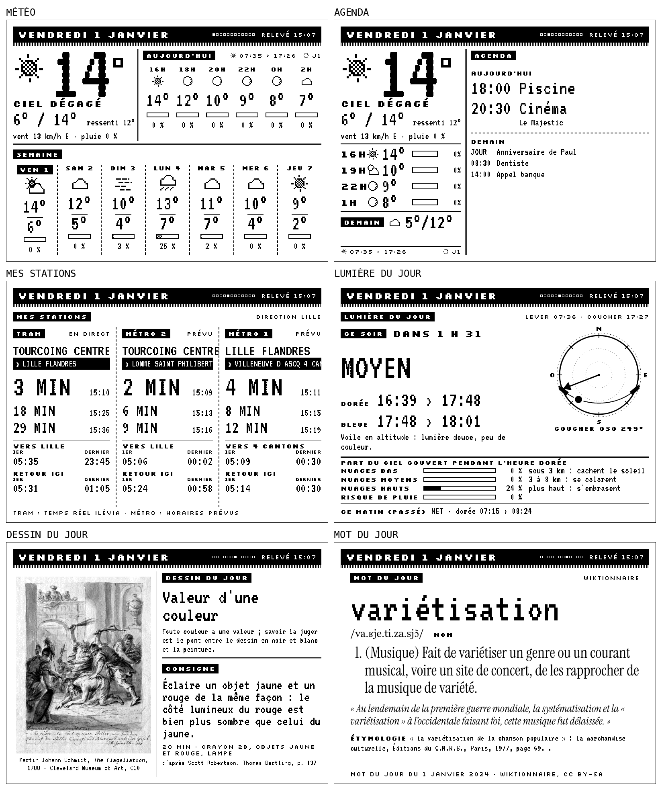

# Kindle dashboard

**Mon vieux Kindle 4 est devenu un écran d'affichage permanent : météo, qualité de l'air, agenda, courrier, tram et métro en direct, dessin du jour, lumière pour la photo, mot du jour, citation, article insolite de Wikipédia, récap de fin de journée, et les chiffres de mon activité.**

Mon Mac fabrique les images, la liseuse ne fait que les afficher. Chaque minute, un script rassemble les données, remplit une page HTML, la photographie avec Chromium à la taille exacte de la dalle et la passe en 16 niveaux de gris. La liseuse, jailbreakée et branchée sur un chargeur, lit l'état du Mac en wifi toutes les 20 secondes et ne télécharge l'écran que s'il a changé. Style néo-rétro : polices pixel à leurs tailles natives, titres inversés, trames, aucun texte gris.



*Écrans fabriqués par `demo.py`, sans aucun compte (agenda fictif). Sur la liseuse, ils sortent en 800 × 600, 16 gris, tournés dans le sens de la dalle.*

> Je suis Thomas Hammoudi, photographe. J'ai construit tout ça avec Claude Code, en 2026. Les textes et le code sont en français.

## Essayer en deux minutes, sans liseuse

```bash
git clone https://github.com/ThomasHMD/kindle-dashboard
cd kindle-dashboard
python3 -m pip install -r requirements.txt
python3 -m playwright install chromium
python3 demo.py
```

Les écrans arrivent dans `demo/` : `apercu-<écran>.png` (paysage, pour l'œil) et `ecran-<écran>.png` (tourné, le fichier que la liseuse affiche). Sans `config.json`, `demo.py` prend les réglages de [`config.exemple.json`](config.exemple.json) : météo de Lille, trois stations du réseau ilévia, aucun agenda ni courrier réel.

## Les écrans

| Écran | Ce qu'il montre | Source | Il faut |
|---|---|---|---|
| Météo | maintenant, ressenti, vent, pluie, la journée de 2 h en 2 h, 7 jours, lever et coucher, phase de la lune | [Open-Meteo](https://open-meteo.com/) | rien |
| Qualité de l'air | indice européen et son niveau, conseil, polluant en cause, indice sur 24 h, particules, dioxyde d'azote et ozone expliqués à l'écran, meilleure heure pour aérer, pollens en saison | [Open-Meteo](https://open-meteo.com/en/docs/air-quality-api) | rien |
| Agenda | rendez-vous d'aujourd'hui et de demain, passés retirés | Google Agenda, lecture seule | un client OAuth, `autoriser.py` |
| Courrier | mails non lus que Gmail marque « Important », écran sauté s'il n'y en a pas | Gmail, lecture seule | idem |
| Abonnés | abonnés par réseau, gain par jour sur 30 jours | une table [n8n](https://n8n.io/) remplie chaque jour par un workflow | `N8N_API_KEY`, facultatif |
| Mon activité | dernière vidéo YouTube longue et dernier reel avec leurs vues ; ventes et nouveaux inscrits du jour, sur 7 jours et du mois | YouTube, API Instagram, une base Notion, Brevo | les clés de chaque source, facultatif, voir `activite` |
| Mes stations | 3 prochains départs, direction, premier et dernier départ du jour, premier et dernier retour | ilévia (Lille) : temps réel et GTFS | rien |
| Lumière du jour | prochain moment photo (ce matin, ce soir ou demain matin) et son verdict (net, prometteur, moyen, bouché, pluie), heures bleue et dorée, boussole de la course du soleil, part du ciel couvert par étage de nuages pendant l'heure dorée, chaque étage expliqué à l'écran | calcul local (formules NOAA) et Open-Meteo | rien |
| Dessin du jour | un concept, une consigne de 10 à 30 min, un dessin ancien du domaine public | [`consignes-dessin.json`](consignes-dessin.json), [Cleveland Museum of Art](https://openaccess-api.clevelandart.org/) (CC0) | rien (Notion, facultatif) |
| Livre à lire | un livre de ma bibliothèque que je n'ai pas encore lu, couverture tramée | une base Notion | `NOTION_TOKEN`, facultatif |
| Mot du jour | mot, prononciation, définitions, exemple, étymologie | [Wiktionnaire](https://fr.wiktionary.org/) | rien |
| Citation | le matin la citation du jour de Wikiquote si elle existe, sinon une de la banque | [`citations.json`](citations.json) | rien |
| Article insolite | un article de la page « Articles insolites » de Wikipédia, sa ligne de présentation, son résumé et son image | [`insolites.json`](insolites.json), API Wikipédia | rien |
| Fin de journée | à partir de 17 h : météo de demain, premier rendez-vous, poubelles à sortir | Open-Meteo, Google Agenda | idem Agenda |
| Demain | la nuit, les rendez-vous du lendemain | Google Agenda | idem Agenda |

Le bandeau du haut porte la date, une case par écran (pleine pour celui affiché), le nombre de mails importants, et la veille du ramassage un rappel des poubelles. Un écran sans réglage (pas de station, pas de base Notion) sort de la rotation et des boutons. Une source en panne affiche un message dans son bloc : l'écran sort toujours.

## Côté Mac

Il faut un Mac allumé en permanence (le serveur tourne en agent launchd ; sous Linux, un service systemd ferait la même chose), Python 3.11 ou plus récent, et le Chromium de Playwright.

1. **Réglages** : `cp config.exemple.json config.json`, puis lieu, agendas, stations (voir « Réglages »). `config.json` n'est jamais versionné.
2. **Clés**, dans un fichier `.env` à côté des scripts ou dans un dossier parent (le plus proche gagne ; une variable d'environnement passe avant) :

   | Variable | Pour |
   |---|---|
   | `KINDLE_JETON` | une chaîne au hasard, que la liseuse présente au serveur ; sans elle, le serveur sert tout à tout le réseau local |
   | `GOOGLE_CLIENT_ID`, `GOOGLE_CLIENT_SECRET` | un client OAuth Google de type « Application de bureau », API Gmail et Agenda activées |
   | `GOOGLE_KINDLE_REFRESH_TOKEN` | écrit par `python3 autoriser.py` (consentement en lecture seule, mails et agenda) |
   | `NOTION_TOKEN` | facultatif : concepts de dessin, livre à lire |
   | `N8N_API_KEY` | facultatif : abonnés |
   | `GOOGLE_API_KEY`, `META_SYSTEM_USER_TOKEN`, `BREVO_API_KEY` | facultatif : Mon activité (YouTube, Instagram, inscrits) ; les ventes passent par `NOTION_TOKEN` |

3. **Serveur** : `python3 serveur.py` relance `dashboard.py --tous` à chaque minute (borné à 110 s) et sert sur le port 8765 l'état, les écrans et les scripts de la liseuse. Pour qu'il démarre avec la session et revienne s'il tombe : adapter les chemins de [`com.exemple.kindle-dashboard.plist`](com.exemple.kindle-dashboard.plist), le copier dans `~/Library/LaunchAgents/`, puis `launchctl bootstrap gui/$(id -u) ~/Library/LaunchAgents/com.exemple.kindle-dashboard.plist`. Les écrans sont écrits dans `~/Library/Caches/kindle-dashboard/`.
4. **Scripts de la liseuse** : `python3 publier.py` contrôle chaque script (`dash -n`, pas de fin de ligne Windows) et le copie là où le serveur le sert. C'est le seul chemin : un fichier en cours d'écriture ne part jamais sur la liseuse. La liseuse se met à jour toute seule au passage suivant.
5. **Santé** : `python3 verifier.py` (code 0 ou 1) : serveur, écrans frais, liseuse vue depuis moins de 10 min, version des scripts, horloge, autorisation Google valable, journal de la liseuse.

`dashboard.py` seul : `--modele k4|k5|touch|pw1`, `--rotation 90|270` selon le sens de pose, `--heure 2026-01-01T08:15` pour simuler un moment, `--tous` pour rendre tous les écrans.

## Côté liseuse

Je l'ai testé sur mon **Kindle 4** non tactile (2011, firmware 4.1.4). Le Kindle 5e génération (2012), le Touch et le Paperwhite 1 sont prévus par `--modele`, mais je ne les ai pas essayés. Il faut un wifi 2,4 GHz en WPA2.

1. **Jailbreak** : pour le Kindle 4, le [K4-Jailbreak de KindleModding](https://github.com/KindleModding/K4-Jailbreak), par le mode diagnostic, sans wifi ni compte Amazon. Les autres modèles et les pièges sont dans [`RECHERCHE.md`](RECHERCHE.md) §2. Ne jamais réinitialiser un Paperwhite 1 : Amazon refuse ensuite de l'enregistrer.
2. **KUAL** (le lanceur d'extensions) dans `documents/`, depuis [kindlemodding.org](https://kindlemodding.org/).
3. Liseuse branchée en USB, copier à la racine du disque `liseuse/dashboard/` (il devient `/mnt/us/dashboard/`) et `liseuse/extensions/kindle-dashboard/` dans `extensions/`. Avant : mettre l'adresse du Mac dans `dashboard/config.sh` (`SERVEUR=`) et la valeur de `KINDLE_JETON` dans un fichier `dashboard/jeton`. Supprimer ensuite les fichiers `._*` que macOS laisse sur le disque.
4. Éjecter, activer le wifi, puis KUAL > Kindle-dashboard > **Démarrer le dashboard**. Le démarrage automatique s'installe au premier lancement : le dashboard repart seul 90 s après chaque allumage.

Ensuite, plus besoin du câble : `python3 liseuse.py '<commande shell>'` exécute une commande sur la liseuse (en root, sortie et code de retour affichés), `--pousser local /chemin/distant` copie un fichier, `--journal 50` lit son journal, `--redemarrer` la relance.

**Boutons** (liseuse couchée en paysage) : pavé → ou ↓ = écran suivant, ← ou ↑ = précédent (boutons de page aussi) ; l'écran choisi reste 10 min. Accueil, Retour ou clic du pavé = reprendre la rotation. **Menu deux fois** = quitter le dashboard et retrouver l'interface Amazon.

### Ce qui tient quand quelque chose lâche

| Panne | Réaction |
|---|---|
| Mac muet 2 min | la liseuse affiche d'elle-même l'écran en cours avec un bandeau « HORS LIGNE » et l'heure des dernières nouvelles |
| Mac muet 5 min | relance du wifi, puis recherche du Mac sur tout le réseau local (`/sonde`) ; recommence toutes les 15 min |
| Mise à jour des scripts abîmée ou cassée | refusée (taille et md5) ; si elle plante, la version précédente revient toute seule (`noyau.sh`, jamais mis à jour à distance, puis `superviseur.sh`) |
| Boucle bloquée | tuée par un chien de garde après 10 min sans battement, relancée |
| Horloge de la liseuse fausse | remise à l'heure du Mac au-delà de 30 s d'écart |
| Liseuse redémarrée branchée au Mac | elle passe en clé USB ; `serveur.py` l'éjecte au bout de 2 min (sauf fichier `garder-usb` dans le dossier de sortie) |
| `dashboard.py` trop long | arrêté à 110 s ; la liseuse garde les derniers écrans, l'heure du relevé dans le bandeau dit leur âge |

Le jeton passe en clair sur le réseau local : il arrête un appareil curieux, pas quelqu'un qui écoute le wifi. La liseuse ne vérifie pas le Mac. Ça me va pour une vieille liseuse sans compte ni donnée.

## Rotation

`PLAYLIST` dans [`dashboard.py`](dashboard.py), par plage horaire, en secondes par écran. Un écran change toutes les 5 minutes environ : assez pour voir passer le dessin et le mot plusieurs fois par jour, pas assez pour que les flashs dérangent.

| Plage | Écrans (minutes) |
|---|---|
| Matin, 06:30 à 09:00 | Météo 6, Stations 6, Agenda 6, Lumière 5, Courrier 4, Air 3, Mot 4, Citation 3 |
| Journée, 09:00 à 19:00 | Météo 8, Agenda 6, Courrier 5, Abonnés 4, Activité 4, Air 4, Stations 6, Dessin 6, Lumière 6, Livre 4, Mot 4, Citation 3, Insolite 4, Fin de journée 5 (dès 17 h) |
| Soirée, 19:00 à 23:00 | Météo 5, Stations 6, Agenda 4, Fin de journée 4, Dessin 8, Livre 6, Insolite 5, Mot 4, Citation 3 |
| Nuit, 23:00 à 06:30 | Demain, fixe |

Trois écrans n'entrent dans le cycle que s'ils ont quelque chose à dire : **Courrier** s'il y a un mail important non lu ; **Stations** dans ses créneaux (`stations_creneaux`) et dans les 2 h avant un rendez-vous d'un agenda de sorties, puis fixe dans les 45 dernières minutes ; **Lumière** autour de l'heure bleue et de l'heure dorée. Flash complet à chaque changement d'écran, partiel pour la mise à jour d'un écran qui reste (les minutes du tram).

Je l'ai sur mon bureau toute la journée : pour ne pas revoir les mêmes l'après-midi, dessin, livre, mot, citation et article insolite sont retirés à 13 h (`RETIRAGE` dans [`dashboard.py`](dashboard.py)).

## Réglages

`config.json` (modèle : [`config.exemple.json`](config.exemple.json)) :

| Clé | Rôle |
|---|---|
| `lieu` | `nom`, `lat`, `lon` de la météo et du soleil |
| `agendas` | `{calendarId: libellé}` des agendas Google à lire (`primary` = l'agenda principal) |
| `agendas_sorties`, `pas_une_sortie` | libellés des agendas où un rendez-vous veut dire « sortir » (écran Stations), et motif des rendez-vous à ignorer (le sport, en voiture) |
| `poubelles` | `{jour: texte}` du rappel dans le bandeau, la veille au soir (0 = rappel le lundi) |
| `notion` | `concepts` et `bibliotheque` : identifiants de data sources Notion ; `jeton_bibliotheque` : nom de la variable du jeton |
| `abonnes` | adresse de la table n8n (`/api/v1/data-tables/<id>/rows`) |
| `activite` | écran Mon activité : `chaine` (identifiant de chaîne YouTube, `UC…`), `instagram` (identifiant du compte professionnel), `ventes` (data source Notion avec `Date`, `Prix final`, `Remboursement`), `listes` (identifiants de listes Brevo). Chaque bloc vide affiche un tiret ; tout vide, l'écran sort du cycle |
| `stations` | une entrée par colonne : `nom`, `mode` (étiquette), `parent` (stop_id de la station dans le GTFS), `ligne` (route_id), `sens` (direction_id), `direct` ([nom_station, sens_ligne] du temps réel, tram seulement), `vers` (où va ce sens, en clair) |
| `stations_creneaux` | créneaux fixes de l'écran Stations : `jour` (0 = lundi), `de`, `a`, `texte` |
| `ecrans_retires` | écrans à ne jamais afficher |
| `google_client` | noms des deux variables du client OAuth, si ce ne sont pas `GOOGLE_CLIENT_ID` et `GOOGLE_CLIENT_SECRET` |
| `contact` | une adresse web ou un mail, mis dans l'agent utilisateur des appels à Wikimedia (leur politique le demande) |

Pour trouver `parent`, `ligne` et `sens` d'une station ilévia : `stops.txt` (les quais ont la station pour `parent_station`), `routes.txt` et `trips.txt` du [GTFS](https://media.ilevia.fr/opendata/gtfs.zip). Ailleurs qu'à Lille, `horaires_prevus()` lit n'importe quel GTFS (changer `ILEVIA_GTFS` dans `dashboard.py`) ; seul le temps réel (`stations()`) est propre à ilévia : sans `direct`, une station s'affiche d'après les horaires prévus.

La base Notion de la bibliothèque doit avoir les propriétés `Titre`, `Auteurs`, `Éditeur`, `Date de publication`, `Pages`, `Possession` (case), `Lu` (choix « Non »), `Résumé`, `Tags`, `Type` et une formule `Chemin de la couverture (calc.)` qui donne l'adresse de l'image ; `Suggéré ?` (formule) est facultative. La base des concepts : `Concept` et `Définition`. Sans base de concepts, le dessin du jour prend les 21 concepts de `consignes-dessin.json`.

## Ce que j'ai appris en chemin

- **ilévia, temps réel** (`dsp_ilevia:prochains_passages`, OGC API de la Métropole européenne de Lille, sans clé) : les heures portent un « Z » mais sont à l'heure de Paris ; seulement les 3 prochains passages par sens ; le métro n'y est pas. Le métro, les premiers et derniers passages, et le tram quand le temps réel se tait, viennent donc du **GTFS** (9 Mo, téléchargé au plus une fois par jour) : services par `calendar_dates.txt` seulement, heures au-delà de 24:00 pour la nuit, deux jours de service lus pour passer minuit.
- **BusyBox 1.7.2** (celui du Kindle 4, 2007) : `wget` sans `--header` (le jeton passe dans l'agent utilisateur, `-U`) et sans délai ; `timeout` seulement en `timeout -t 5` (`timeout 5` plante) ; pas de `od`, de `command -v` ni de `grep -E` ; `printf` n'est pas intégré au shell (50 ms par appel). Les scripts sont contrôlés sur le Mac par `dash -n` avant d'être servis.
- **Touches** : un `dd` et un `hexdump` par évènement de `/dev/input/event*`, périphérique gardé ouvert ; 0,7 s d'un appui à l'écran (dont 0,36 s d'`eips`).
- **E-ink** : polices pixel seulement à leurs tailles natives (VT323 25, 50, 75… ; Silkscreen 16, 24), sans lissage ; aucun texte gris sur une dalle Pearl ; images au contraste étiré puis tramées en 16 gris (Floyd-Steinberg), l'arrondi simple fait des bandes. Mesures et sources : [`RECHERCHE-DESIGN.md`](RECHERCHE-DESIGN.md).
- **Dessins pour l'e-ink** : l'API ouverte du Cleveland Museum renvoie aussi des aquarelles et des feuilles pâles ; `affichable()` garde les techniques graphiques (graphite, craie, plume, fusain, lavis), écarte la couleur, les rectos-versos, les formats extrêmes, et exige une encre entre 4 et 45 % de la surface (seuils calés sur 20 dessins).
- **Wiktionnaire** : le mot du jour est programmé d'avance, sa page peut ne pas encore exister, ou ne jamais exister (je prends alors celui du même jour une année passée, comme pour le second mot de la journée) ; sans agent utilisateur conforme à la politique de Wikimedia, l'API répond 429.
- **Google** : un client OAuth en mode « Test » voit ses jetons expirer en 7 jours ; `verifier.py` fait un vrai échange de jeton pour le voir venir.

## Fichiers

| Fichier | Rôle |
|---|---|
| [`dashboard.py`](dashboard.py) | rassemble les données, remplit `gabarit.html`, photographie chaque écran (Playwright), le passe en 16 gris et le tourne |
| [`gabarit.html`](gabarit.html), [`polices/`](polices) | mise en page et style ; VT323, Silkscreen, Instrument Serif en local |
| [`serveur.py`](serveur.py) | génère chaque minute, sert l'état, les écrans et les scripts, garde l'écran choisi aux boutons, note chaque passage de la liseuse |
| [`publier.py`](publier.py) | seul chemin des scripts vers la liseuse, après contrôle |
| [`liseuse.py`](liseuse.py) | commandes et copies sur la liseuse par le wifi |
| [`verifier.py`](verifier.py) | santé en une commande |
| [`autoriser.py`](autoriser.py) | consentement Google en lecture seule, jeton écrit dans le `.env`, jamais affiché |
| [`citations.py`](citations.py) | refait `citations.json` depuis Wikiquote (une fois par mois suffit) |
| [`insolites.py`](insolites.py) | refait `insolites.json` depuis la page Wikipédia (une fois par mois suffit) |
| [`demo.py`](demo.py) | tous les écrans sans compte |
| [`liseuse/dashboard/`](liseuse/dashboard) | scripts de la liseuse : `noyau.sh` > `superviseur.sh` > `boucle.sh` et `touches.sh` ; `demarrage-auto.sh`, `tester.sh`, `config.sh` |
| [`liseuse/extensions/kindle-dashboard/`](liseuse/extensions/kindle-dashboard) | menu KUAL |
| [`RECHERCHE.md`](RECHERCHE.md) | identifier une liseuse, jailbreak par modèle, afficher une image, USB ou wifi, projets existants, batterie |
| [`RECHERCHE-DESIGN.md`](RECHERCHE-DESIGN.md) | dashboards e-ink réussis, règles de l'e-ink, cadence de rotation, maquettes |

## Licence

Code et textes sous **[licence MIT](LICENSE)**. Les polices gardent la leur (SIL Open Font License 1.1, dans [`polices/`](polices)) ; `citations.json` reprend les citations du jour de Wikiquote en français et `insolites.json` les lignes de la page « Articles insolites » de Wikipédia (CC BY-SA 4.0). Le Wiktionnaire et les images du Cleveland Museum sont lus à l'exécution, rien n'en est redistribué. Détail : [`LICENCES-TIERS.md`](LICENCES-TIERS.md).

Kindle est une marque d'Amazon. Ce projet n'est ni affilié à Amazon, ni à ilévia, ni à la Métropole européenne de Lille.

## In English

My always-on dashboard on a jailbroken Kindle 4 (2011): weather, calendar, mail, live tram and metro departures (Lille's ilévia network, real-time API and GTFS), drawing prompt of the day with a public-domain drawing from the Cleveland Museum of Art, golden and blue hour forecast, French word and quote of the day, an odd Wikipedia article, an end-of-day recap, and my YouTube, Instagram and sales numbers. My Mac renders each screen from HTML with headless Chromium, dithers it to 16 grays and serves it over the local network; the Kindle polls every 20 seconds, updates itself, survives Mac outages and bad updates. Try it without a Kindle or any account: `python3 demo.py`. Code and docs are in French; MIT licence.
